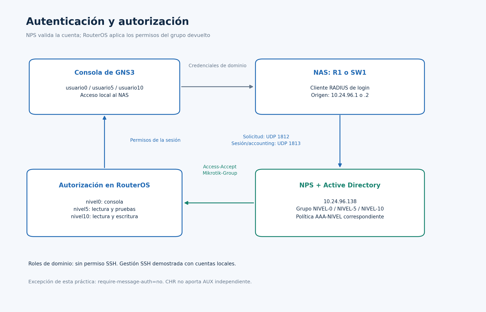
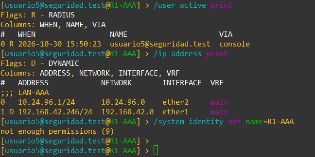
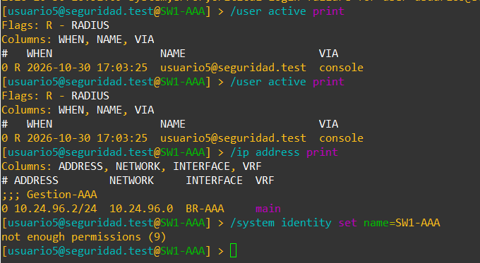

🎥 **Video demostrativo en YouTube: PENDIENTE DE PUBLICAR Y AÑADIR EL ENLACE.**

# Laboratorio de seguridad de redes: AAA con MikroTik, Active Directory y NPS

**Autor:** Reymond Daniel Guerrero Cruz · **Matrícula:** 2024-0963 · **Fecha del laboratorio:** 30 de octubre de 2026.

## Propósito del laboratorio

Centralizar la autenticación de un router y un switch mediante RADIUS y Active Directory, y aplicar permisos diferentes según el grupo del usuario. La práctica demuestra acceso por consola para los roles 0, 5 y 10, administración SSH con cuentas locales y consulta de registros de NPS y RouterOS.

Este repositorio reúne toda la práctica: documentación, capturas originales, diagramas, scripts y configuraciones de los dos MikroTik. Se utilizaron GNS3, VMware, dos CHR con RouterOS 7.23.7 y Windows Server 2022.

## Topología y direccionamiento

| Equipo | Función | Dirección / interfaz |
|---|---|---|
| R1-AAA | Router, NAT y cliente RADIUS | LAN 10.24.96.1/24 en ether2; WAN por DHCP en ether1 |
| SW1-AAA | Switch mediante BR-AAA y cliente RADIUS | 10.24.96.2/24; bridge con ether1, ether2 y ether3 |
| Windows Server 2022 | Active Directory, DNS y NPS | 10.24.96.138/24; dominio seguridad.test |
| NAT1 | Salida del laboratorio | Conectado a ether1 de R1 |

La [captura original de GNS3](imagenes/topologia-gns3-real.png) muestra el montaje real. Los puertos e0/e1/e2 de los CHR en GNS3 corresponden a ether1/ether2/ether3 en RouterOS. [Cableado y flujo de AAA](docs/topologia.md).

## Autenticación y autorización

NPS valida las cuentas de AD y devuelve el atributo Mikrotik-Group. RouterOS aplica los permisos del grupo recibido. R1 y SW1 están registrados como clientes RADIUS en NPS; utilizan UDP 1812 para autenticación y UDP 1813 para accounting.

| Usuario de AD | Grupo de AD | Política de NPS | Grupo RouterOS | Permisos previstos |
|---|---|---|---|---|
| usuario0 | NIVEL-0 | AAA-NIVEL-0 | nivel0 | Consola; sin lectura de configuración |
| usuario5 | NIVEL-5 | AAA-NIVEL-5 | nivel5 | Consola, lectura y pruebas |
| usuario10 | NIVEL-10 | AAA-NIVEL-10 | nivel10 | Consola, lectura, escritura y pruebas |

Estos tres grupos carecen de permiso SSH. La gestión SSH se demostró con admin en R1 y admin-local en SW1. Se observaron las cuentas locales admin y admin-local en ambos equipos. Los números de nivel son roles definidos para esta práctica. [Permisos y pruebas](docs/roles-y-pruebas.md).

## Evidencias de funcionamiento

### Nivel 5 en R1

### Nivel 5 en SW1

La bandera R identifica sesiones autenticadas mediante RADIUS. Las capturas muestran lectura permitida y escritura rechazada para nivel 5. También se incluyen las pruebas de nivel 0, nivel 10, SSH y pertenencia a AD en el [inventario de evidencias](docs/evidencias.md), que distingue las capturas históricas de la configuración final.

## Configuraciones y scripts

| Archivo / carpeta | Contenido |
|---|---|
| [configs/R1-AAA.rsc](configs/R1-AAA.rsc) | Export real de la configuración activa del router |
| [configs/SW1-AAA.rsc](configs/SW1-AAA.rsc) | Export real de la configuración activa del switch |
| [configs/nps-politicas-documentadas.json](configs/nps-politicas-documentadas.json) | Especificación documental de las políticas; no es un export nativo de NPS |
| [scripts](scripts/README.md) | Procedimientos PowerShell, consultas RouterOS y generador de diagramas |
| [Comandos utilizados](scripts/COMANDOS-UTILIZADOS.md) | Registro del procedimiento, sin valores de credenciales |

Los archivos .rsc corresponden al equivalente documental de las running-configs en RouterOS. Conservan el estado recibido y omiten secretos; no contienen una copia completa de las máquinas virtuales. Los procedimientos de instalación son para reconstrucción y no se deben repetir sobre el laboratorio ya funcionando. [Detalle de las configuraciones](configs/README.md).

## Documentación

- [Relación entre requisitos y archivos entregados](docs/requisitos.md).
- [Topología, puertos y flujo AAA](docs/topologia.md).
- [Configuración del router y del switch](docs/configuracion-router-switch.md).
- [Active Directory y NPS](docs/ad-y-nps.md).
- [Usuarios, permisos y pruebas](docs/roles-y-pruebas.md).
- [Inventario de capturas y evidencias pendientes](docs/evidencias.md).
- [Incidencias y soluciones](docs/incidencias.md).
- [Alcance y limitaciones](docs/alcance-y-limitaciones.md).
- [Fuentes técnicas](docs/fuentes.md).

## Alcance de la implementación

Se confirmó el acceso de usuario0, usuario5 y usuario10 en ambos NAS. La documentación conserva las pruebas recibidas y los exports reales. CHR no proporciona un AUX independiente en este montaje; los permisos por grupo implementan la adaptación de acceso por consola. Ambos exports conservan require-message-auth=no como excepción temporal de compatibilidad con el NPS observado. Su cierre y los registros todavía pendientes se detallan en [alcance y limitaciones](docs/alcance-y-limitaciones.md).
