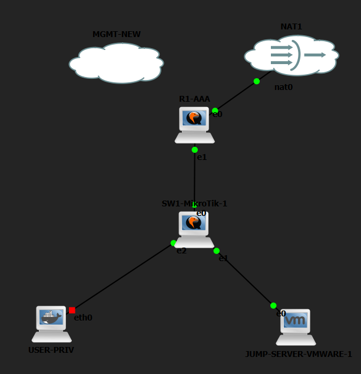
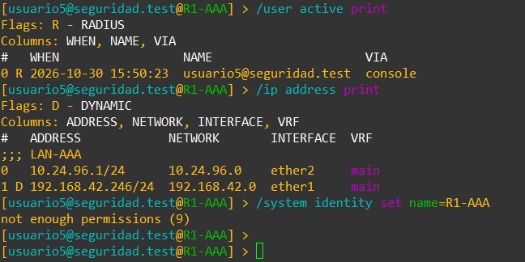
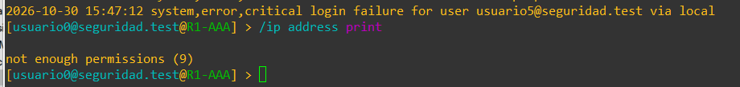
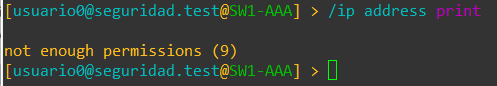
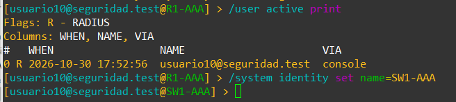
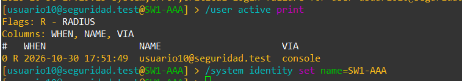

# Inventario de evidencias y comprobaciones finales

Las capturas se conservan completas, sin recortes ni retoques. Los diagramas se elaboraron a partir de los exports y del cableado visible; se distinguen de la captura real de GNS3.

| Prueba | Evidencia disponible |
|---|---|
| R1, nivel 5 por RADIUS | r1-nivel5.png: bandera R, consulta de IP y escritura denegada |
| SW1, nivel 5 por RADIUS | sw1-nivel5-actual.png: bandera R, consulta de IP y escritura denegada |
| R1, nivel 0 | r1-nivel0-lectura.png: cuenta de dominio en consola y lectura denegada |
| SW1, nivel 0 | sw1-nivel0-lectura.png: cuenta de dominio en consola y lectura denegada |
| R1, nivel 10 | r1-nivel10-escritura-antes-nombre.png: bandera R y escritura aceptada; cambia identity a SW1-AAA en esa prueba histórica |
| SW1, nivel 10 | sw1-nivel10-captura-parcial.png: bandera R y comando de escritura; la línea inferior está cortada en el original |
| SSH local de SW1 | sw1-ssh-local.png: admin-local, origen 10.24.96.138, vía ssh |
| SSH local hacia R1 | r1-ssh-captura-completa.png: conexión a 10.24.96.1 con admin y vía ssh; prompt anterior a corregir identity |
| Usuario10 en NIVEL-10 | ad-usuario10-grupo.png |
| Usuario10 controlado por NPS | ad-usuario10-dialin.png |
| Topología actual GNS3 | topologia-gns3-real.png: router, switch, servidor, NAT, USER-PRIV detenido y MGMT-NEW sin enlace |
| Configuración de NAS | Exports reales R1-AAA.rsc y SW1-AAA.rsc, ambos en configs de este repositorio |
| Política AAA-NIVEL-10 corregida | Corrección y acceso final confirmados; captura final de Conditions pendiente |
| Denegación de SSH de cuentas de dominio | Configurada por grupos; prueba negativa pendiente de evidencia |
| AUX | No disponible en el montaje CHR aportado |
| Protección de respuestas RADIUS | Pendiente de cerrar la excepción require-message-auth=no |
| GitHub / YouTube | Pendientes de publicación y de completar los enlaces |

## Contexto de nombres y capturas

La escritura de nivel 10 en R1 aceptó el nombre SW1-AAA. Esa captura demuestra el permiso de escritura y explica el nombre mostrado en una sesión SSH posterior. No representa el nombre final: el export recibido de R1 ya contiene R1-AAA y 10.24.96.1/24 en ether2.

Las dos capturas adicionales de escritura denegada de nivel 0 muestran un prompt SW1-AAA y se conservan como apoyo; no se usan para atribuir un equipo diferente sin otra identificación.

La imagen de nivel 10 de SW1 conserva el corte inferior del archivo original. Para una evidencia de entrega más clara, añadir una captura que muestre completa la vuelta al prompt después de la escritura.

En las imágenes que incluyen fallos anteriores se separa ese historial de la prueba actual; no se presentan como fallos del estado final.

## Validaciones complementarias

1. Completar la captura de escritura de nivel 10 en SW1, conservando el nombre actual.
2. Mostrar Conditions de AAA-NIVEL-10 con NIVEL-10 y el orden de las políticas.
3. Mostrar métodos de autenticación finales y el atributo de grupo de cada política.
4. Mostrar eventos NPS recientes, con NAS y cuenta identificados, y una denegación controlada.
5. Mostrar /system console print y /port print para documentar serial0 y la limitación AUX.

## Galería de evidencias

