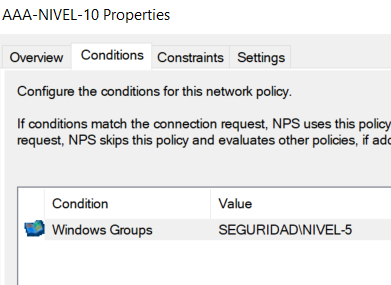

# Incidencias resueltas y decisiones

## Solicitudes sin respuesta

Los contadores del NAS acumularon timeouts. Se comprobó que existían ambos clientes de NPS y que IAS escuchaba. SW1 hizo ping al servidor con 4/4 respuestas. Packet Monitor, limitado a 10.24.96.2 y UDP 1812, registró tres paquetes recibidos por Windows y ninguna respuesta transmitida.

Una consulta amplia del proveedor NPS mostró System ID 18: Message-Authenticator no válido para 10.24.96.2. Se sincronizó la clave RADIUS privada en NPS y SW1 y se reinició IAS. El inicio de sesión de usuario5 en SW1 quedó demostrado con bandera R.

Un ping correcto solo verificó conectividad IP. La captura distinguió recepción de paquetes y respuesta, y el evento de NPS permitió identificar el motivo.

## Respuestas descartadas por el NAS

En R1 se observaron concesiones 6272 de NPS, mientras el NAS aumentaba bad-replies. Su log indicó missing message auth. Se aplicó temporalmente require-message-auth=no. La limitación y el cierre pendiente se explican en alcance-y-limitaciones.md.

## Usuario10 rechazado

El evento 6273 mostró Reason Code 65 y la política Connections to other access servers. Se revisaron los permisos dial-in y la pertenencia a NIVEL-10.

La captura de AAA-NIVEL-10 reveló que su condición todavía era SEGURIDAD\NIVEL-5. Se sustituyó por SEGURIDAD\NIVEL-10. Después de corregir la condición, se confirmó el acceso de usuario10 en R1 y SW1.

Esta imagen documenta la incidencia anterior. No acredita la condición final corregida; se debe añadir una captura actual de AAA-NIVEL-10.

## Cuenta local y SSH

En R1 falló el intento de SSH con admin-local. La contraseña conocida correspondía al acceso con admin, con el que se obtuvo la sesión SSH. En SW1 se había demostrado SSH con admin-local.

El prompt de R1 llegó a mostrar SW1-AAA durante las pruebas de escritura. La captura de SSH conserva ese estado anterior. El export final de R1 identifica la LAN 10.24.96.1 en ether2, la WAN DHCP y system identity R1-AAA.

La prueba de escritura reutilizable usa el nombre actual del propio equipo, para evitar ese cambio accidental.

## Recuperación de GNS3

Después de un fallo de conexión al controlador localhost:3080 se reinició el equipo y se abrió primero VMware con GNS3 VM, se esperó su arranque y después se inició GNS3 una sola vez. Se confirmó que el proyecto volvió a abrir. Los errores de conexión por sí solos no acreditaron pérdida de proyectos.
