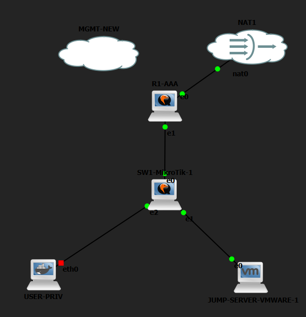
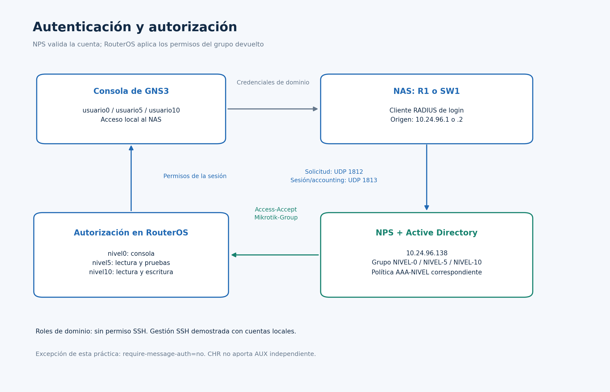

# Topología y direccionamiento

## Captura real del montaje

## Equipos del montaje

| Equipo | Plataforma / función | Dirección |
|---|---|---|
| R1-AAA | MikroTik CHR 7.23.7, router y cliente RADIUS | LAN 10.24.96.1/24 en ether2; WAN por DHCP en ether1 |
| SW1-AAA | MikroTik CHR 7.23.7, bridge y cliente RADIUS | 10.24.96.2/24 en BR-AAA |
| Servidor AD/NPS | Windows Server 2022 Standard Evaluation | 10.24.96.138/24 |
| NAT1 | Salida del laboratorio | Conectado a la WAN de R1 |

La dirección WAN observada durante las pruebas fue 192.168.42.246/24 y puede cambiar por DHCP. El diagrama no la trata como dirección fija.

| Origen | Puerto | Destino / función |
|---|---|---|
| NAT1 | Puerto NAT del nodo | R1 ether1 |
| R1 | ether2 | SW1 ether1 |
| SW1 | ether2 | NIC del servidor, Ethernet0 2, ifIndex 4 |
| SW1 | ether3 | USER-PRIV, interfaz eth0; nodo auxiliar detenido en la captura |

La captura actual confirma el cableado del montaje. Las etiquetas e0, e1 y e2 de GNS3 en los CHR se corresponden con ether1, ether2 y ether3 de RouterOS. SW1 aparece como SW1-MikroTik-1 en el lienzo, aunque su identity de RouterOS es SW1-AAA. El servidor aparece como JUMP-SERVER-VMWARE-1 en GNS3; su hostname de Windows observado es WIN-E4RSOHRPSJM.

USER-PRIV está enlazado a ether3 de SW1 y muestra un extremo rojo en la captura; se documenta como nodo auxiliar detenido y no participó en las pruebas AAA. MGMT-NEW aparece sin enlace, fuera del camino de autenticación. El diagrama representa estas funciones y conserva las direcciones de los exports.

El servidor utiliza gateway 10.24.96.1 y DNS propio 10.24.96.138. Los reenviadores DNS definidos durante la instalación fueron 1.1.1.1 y 8.8.8.8. El dominio es seguridad.test, nombre NetBIOS SEGURIDAD y OU LAB-AAA. No se requiere un cuarto host para estas pruebas: se usó PowerShell del propio servidor como cliente SSH.

## Flujo de AAA

La consola presenta la cuenta de dominio al NAS. El NAS envía la solicitud a 10.24.96.138 por UDP 1812; NPS usa Active Directory, selecciona la política y devuelve el grupo. RouterOS aplica los permisos del grupo local correspondiente. UDP 1813 se reserva para accounting.

La autorización por comandos se aplica en el NAS. La administración SSH local utiliza las cuentas del propio MikroTik.
